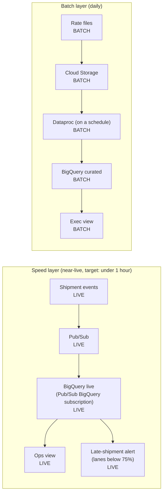

# Platform design for SHP02 · Nordic Home

**Targets:** freshness 1 hour · reliability 75% on time on every lane · budget $45/month
**Lanes (ocean):** NLRTM → USHOU · DEHAM → USNYC · KRPUS → USLGB · SGSIN → BEANR

## Live vs batch
- **Live:** shipment tracking events, Pub/Sub and BigQuery live table, and the ops view. Nordic Home needs data no more than 1 hour old, so events can be written to BigQuery as they arrive.
- **Batch:** carrier rate files, Cloud Storage, Dataproc, curated BigQuery and the exec view. Carriers send rate files once a day, so there is no benefit in processing them faster.

## Changes from the reference platform
- **Removed Kafka:** Pub/Sub alone is enough. Running Kafka as well adds cost and operations work, and our volume and 1-hour target don't justify it.
- **Removed Dataflow:** a streaming Dataflow job runs 24/7 and would use most of the $45 budget. A Pub/Sub BigQuery subscription writes events straight into BigQuery with no job to run, and easily meets a 1-hour freshness target.
- **Dataproc runs only on a schedule:** the cluster is created for the daily rate-file job and deleted afterwards, so we pay for minutes, not for a cluster that sits idle.
- **Added late-shipment view/alert (reliability):** Nordic Home plans store openings around container arrivals, so the ops view should highlight lanes below the 75% on-time target. See `docs/metrics.md` for the lanes that miss it.